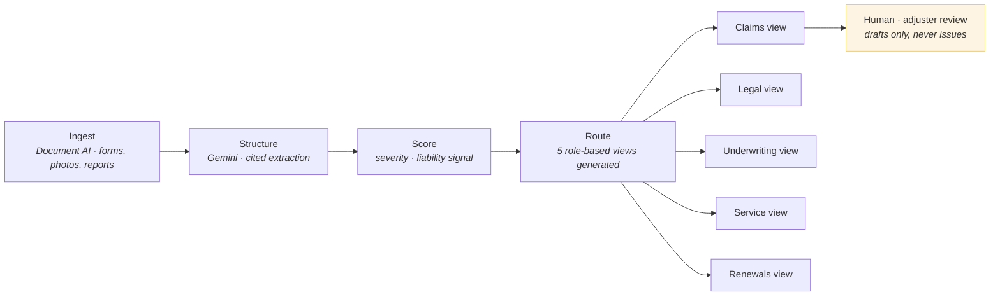

# Vantage

**A single claims record, read five ways — for commercial insurance FNOL triage.**


One Document AI + Gemini pipeline turns a single First Notice of Loss submission into one structured Claim Intelligence Record — and five different functions inside the insurer read from that same record, each seeing only what their role needs. Nobody re-discovers the same claim, late, from a different angle, on a different timeline. The claims decision itself is never made by the system.

## The problem, in one paragraph

A claim doesn't just cost the claims team time — it's a single event with five separate stakeholders, none of whom currently see it at the same moment. The claims handler manually extracts facts from documents that already contain everything needed. Legal finds a subrogation opportunity from the closed file, weeks after the evidence window has narrowed. Underwriting sees loss severity in a renewal review, months after it happened. Customer service has no idea a claim is stuck, so every status question becomes an inbound call. Renewals finds out an account is at churn risk only when the broker has already started shopping it. Five functions, one claim, five different discovery moments — all late.

## Why this domain, specifically

Insurance claims handling isn't a growth line insurers can improve by cutting corners — it's typically the single largest cost component an insurer carries, historically running close to 70% of premium collected, and cycle time keeps getting worse: the average commercial claim now runs 44 days from first notice to final payment, largely because manual intake creates the bottleneck. The retention angle changes who inside the business should care about that number — 41% of claimants who had a poor claims experience report wanting to switch insurers, which puts a slow claim directly upstream of a renewals problem, not just a claims-cost one.

## Live artifact

`vantage-design-doc.html` is a self-contained, interactive living design document — no build step, no dependencies. Open it directly in a browser, or serve it via GitHub Pages. It includes:

- A full client brief, stakeholder map, and problem statement for the fictional anchor client, **Bishopsgate General Insurance**
- An interactive **pipeline simulator** — run a routine, well-evidenced claim through to five populated role-based views, then run a second claim where liability evidence is genuinely ambiguous and watch the system route to a human instead of guessing
- The full ADR set, cost analysis, and rollout roadmap referenced below

```
open vantage-design-doc.html
# or, for a shareable link:
# push to a gh-pages branch and serve via GitHub Pages
```

## Architecture

One record, generated once. Five permissioned reads. No component in this pipeline is authorized to issue a coverage decision, a liability finding, or a payment.



| Stage | Type | Single responsibility |
|---|---|---|
| Ingest | Document AI | Extract structured fields from FNOL forms, photos, and reports |
| Structure | Gemini | Turn extracted fields into a cited Claim Intelligence Record |
| Score | Deterministic + Gemini | Severity scoring, third-party/liability signal detection |
| Route | Deterministic | Generate five role-scoped views from the one record, enforced at the query layer |
| Human review | Adjuster / Legal / Underwriting | Reviews and decides — the system never signs off on coverage, liability, or payment |

**On what "five views" actually means:** this was deliberately not built as five separate agents, one per stakeholder. A separate agent per function would multiply extraction cost five times over for data that's identical at the source, and creates five places the same fact could quietly drift out of sync. One record, five permissioned reads, is the whole design — see [ADR-VT-01](vantage-design-doc.html#s10).

## Design principles

1. **One extraction, many readers — never one extraction per reader.** Legal's subrogation flag and Underwriting's severity signal come from the same record, not parallel pipelines.
2. **The system drafts. It never decides.** Coverage, liability, and payment determinations stay with the human adjuster or counsel of record, without exception — a claims-handling accountability boundary under FCA ICOBS, not a design preference that could be relaxed later.
3. **Access is enforced at the query layer, not the interface.** Renewals cannot retrieve raw claim-file contents even if the UI were modified to try — the boundary is structural.
4. **Confidence-threshold routing, not best-effort auto-population.** A field below a set confidence threshold is flagged and routed to a human, never silently populated as fact.
5. **Read-pattern integration, no re-platforming.** Vantage reads from the insurer's existing claims, underwriting, service, and renewals systems through their existing APIs — none of the four systems has to change to accommodate it.

## Regulatory grounding

| Standard | Requirement | Vantage mechanism |
|---|---|---|
| FCA ICOBS — claims handling | Claims decisions are accountable acts requiring human judgment | Every downstream view is a draft; the handler or counsel makes every determination |
| Data minimization / least privilege | Sensitive claim data shouldn't be visible beyond its need | Field-level access boundary per role, enforced at the query layer, independently auditable from configuration |

This is a narrower regulatory surface than this portfolio's EU AI Act-anchored pieces (Lumen) by design — UK commercial claims handling doesn't carry an Annex III-style high-risk classification, and the document doesn't manufacture one. The case for Vantage is operational and retention-driven, not compliance-driven, and it's presented that way.

## Architecture Decision Records

Five ADRs, each with rejected alternatives named explicitly:

- **ADR-VT-01** — Single record with role-based views, not a per-stakeholder agent
- **ADR-VT-02** — Human-in-the-loop retained for every coverage, liability, and payment decision
- **ADR-VT-03** — Confidence-threshold routing, not best-effort auto-population
- **ADR-VT-04** — Read-pattern integration with existing systems, no re-platforming
- **ADR-VT-05** — Least-privilege view boundary per stakeholder role

Full rationale for each lives in [`vantage-design-doc.html`, §10](vantage-design-doc.html#s10).

## What's built vs. what's designed — stated plainly

This is a systems-design portfolio piece, not a production deployment:

- ✅ Full architecture, ADRs, cost analysis, and rollout roadmap — complete
- ✅ Interactive pipeline simulator demonstrating both the confident-extraction path and the low-confidence hold path — complete, runs client-side, no backend
- ⬜ Real Document AI extraction against live FNOL submissions — not built
- ⬜ Real integration against a live claims management system (e.g. Guidewire ClaimCenter) — not built
- ⬜ Field-level access control actually enforced in a live query layer — designed, not implemented

The honest reason: the interesting design problem here — one extraction, five honest, access-controlled views, with a human decision boundary that never erodes under volume pressure — is fully specified and simulated. Wiring it to a specific insurer's real claims stack is integration work, not a design question, and isn't the part of this exercise worth spending build time on for a portfolio piece.

## Rollout roadmap

| Phase | Scope |
|---|---|
| **1** | Claims Handler view only, Commercial Property line. Document AI + Gemini pipeline, Claim Intelligence Record, handler briefing UI — proves extraction accuracy and cycle-time impact before any other view is built |
| **2** | Add Legal and Underwriting views on the same line — the two views with the clearest, most defensible £ case |
| **3** | Add Customer Service and Renewals views; extend the pipeline to Casualty & Liability and Marine & Cargo lines |

Each phase is independently defensible: if Phase 1 doesn't measurably reduce cycle time on Commercial Property, Phase 2 doesn't proceed on schedule.

## Part of a four-project portfolio

Vantage is the second of four living design documents built on the same design system, each targeting a different regulated financial-services workflow:

| Project | Domain | Regulatory anchor |
|---|---|---|
| **SLUDGE** | Consumer Duty outcomes monitoring | UK FCA Consumer Duty |
| **Vantage** | Commercial insurance claims (FNOL) | UK FCA ICOBS |
| **Lumen** | Life & health underwriting | EU AI Act, Annex III(5)(c) |
| **Corridor** | Cross-border SME trade settlement | UK PSR · EU MiCA/AI Act · US GENIUS Act |

Vantage and Lumen share the same non-negotiable design commitment — a human makes the accountable decision, always — despite sitting in different regulatory regimes. Corridor is the one piece in the portfolio that departs from that pattern, and it argues explicitly for why that departure is legitimate rather than treating "always human" as a rule that bent under different pressure.

## Disclaimer

Bishopsgate General Insurance, Helen Marsh, and every named stakeholder and claim scenario in this repository are fictional constructs built for this portfolio piece. Cited industry figures — FNOL cycle times, claims' share of premium cost, claimant churn intent following a poor claims experience, and digitization cost-reduction ranges — describe real published industry research (Deloitte, McKinsey, Accenture), referenced in full inside the design document. The company and people applying them do not exist. Nothing here constitutes legal or financial advice.

## Author

Built as a portfolio artifact demonstrating applied AI systems design against a real operational and retention problem in commercial insurance claims handling.

---

<sub>License: MIT. Use, adapt, or fork freely.</sub>
